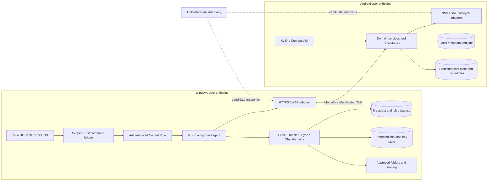

# NARADA — System architecture

> [Documentation index](../README.md) · Planning baseline v1.0 · 30 October 2026  
> Proposed design; implementation and validation are still required.

## Deployment model

NARADA 1.0 is a **modular monolith on Windows plus a native Android client**, not a distributed microservice system.

The Windows agent is a **non-elevated, per-user background process**. It can remain running after the main window closes. Starting at sign-in is user-controlled. It does not promise availability while the user is logged out or the laptop is asleep.

A future machine-wide Windows Service Control Manager service would need a separate account/ACL/key design. It must not casually run as LocalSystem, borrow another user's DPAPI state, or display UI from a service context. Microsoft documents service-account security contexts; see [R5](27-references.md).

## High-level diagram



**Text equivalent:** Desktop UI → constrained local IPC → Windows agent → authorized filesystem/database operations. Android → authenticated LAN connection → Windows API. Both endpoints own their chat keys and durable state. Discovery only finds possible addresses.

## Internal modules and ownership boundaries

| Module | Owns | Must not do |
|---|---|---|
| Lifecycle/config | Startup, validated configuration, shutdown and recovery orchestration | Store plaintext secrets in configuration. |
| Device/security | Pairing, peer identity, grants, revocation and key-store interface | Trust a device label, IP address or JSON sender ID. |
| API/protocol | Schema validation, limits, correlation and transport mapping | Bypass domain authorization or perform arbitrary path access. |
| Files | Root registry, safe resolution, metadata and file mutations | Follow unchecked reparse points or accept absolute client paths. |
| Transfer | Manifests, queues, checkpoints, integrity and publication | Infer completion from bytes sent. |
| Sync | Journals, cursors, pin policies and reconciliation | Treat watcher callbacks as a perfect history. |
| Chat endpoint | E2EE adapter, protected history, outbox, receipts and session transactions | Promise confidentiality from the endpoint process itself. |
| Events | Typed state changes and subscriptions | Act as the sole durable source of truth. |
| Storage | Transactions, migrations and recoverable repository operations | Claim a DB transaction atomically commits a filesystem rename. |
| Platform adapters | Windows handles/IPC; Android storage/jobs/NSD | Leak platform paths or unrestricted native capabilities to UI. |
| Observability | Local counters, safe logs and diagnostic export | Record message bodies, keys, tokens or complete private paths. |

Use dependency direction **UI/adapters → application services → domain rules → repository/platform interfaces**. Infrastructure implements those interfaces. Domains should be testable without a live router or UI.

## Control plane versus data plane

- **Control plane:** Pairing lifecycle, grants, directory metadata, transfer creation, cancellation, journal cursors and receipts.
- **Data plane:** File chunks and encrypted attachment blobs over authenticated HTTPS.
- **Live-event plane:** WebSocket notifications and encrypted message envelopes.
- **Recovery plane:** Durable databases and status queries, not a dependency on an uninterrupted WebSocket.

Large blobs do not travel through UI IPC, JSON base64 fields or the chat-event queue. Reserve capacity for control messages and cancellation even when transfers saturate the network.

## Recommended repository layout

```text
narada/
├── apps/
│   ├── windows-agent/          # narada-agent executable
│   └── desktop-shell/
│       └── src-tauri/          # Tauri commands and capabilities
├── crates/
│   ├── narada-core/
│   ├── narada-protocol/
│   ├── narada-security/
│   ├── narada-storage/
│   ├── narada-files/
│   ├── narada-transfer/
│   ├── narada-sync/
│   ├── narada-chat/
│   ├── narada-network/
│   └── narada-windows/
├── desktop-ui/
│   ├── index.html
│   └── src/
│       ├── app/               # Router, local view state, event bus
│       ├── components/
│       ├── pages/             # Home, Files, Chat, Transfers, Sync, Devices, Settings
│       ├── services/          # Typed IPC facade, no direct disk/network access
│       ├── styles/            # Tokens, base, layout, components
│       └── utils/
├── android/
│   ├── app/
│   ├── core/                  # Model, database, network, security, storage
│   └── feature/               # Pairing, files, chat, transfers, offline, settings
├── protocol/
│   ├── openapi/
│   ├── schemas/
│   └── vectors/               # Shared positive and negative fixtures
├── docs/
│   ├── adr/
│   ├── security/
│   ├── runbooks/
│   └── releases/
├── tests/
├── config/
├── scripts/
├── Cargo.toml
├── Cargo.lock
└── rust-toolchain.toml
```

Start with fewer crates if useful. Do not generate empty modules solely to imitate this tree. Extract boundaries when real behavior and tests justify them.

## Desktop and Android execution rules

**Desktop:** The webview is an untrusted-input rendering boundary. Use explicit command allowlists and Tauri capabilities, restrictive CSP, bundled UI resources, `textContent` for names/messages and no shell execution from content. Plugin capability settings do not replace authorization inside custom Rust commands. See [R7](27-references.md).

**Android:** Compose observes repository state; it does not own active transfer lifetime. Use a single durable job owner/lease so WorkManager, a visible activity and a foreground component cannot run the same transfer simultaneously. Cancellation must release sockets, URI handles and notification state.

**Both:** The database is the recovery source of truth for logical state. The filesystem is independently checked before publishing or resuming physical content. Emit UI events only after the corresponding durable transaction.
