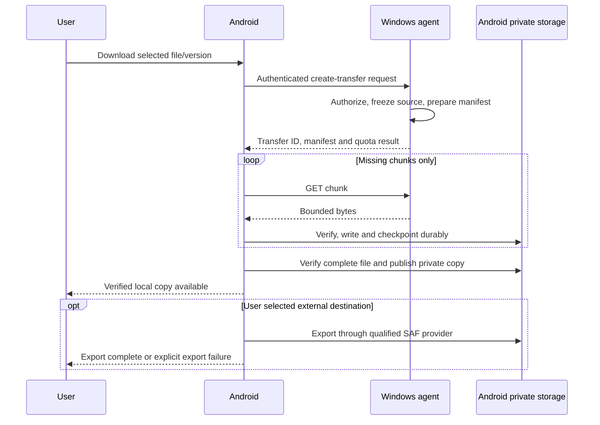

# NARADA — End-to-end working and user journeys

> [Documentation index](../README.md) · Planning baseline v1.0 · 30 October 2026  
> Proposed design; implementation and validation are still required.

## Startup and recovery

1. Confirm the single-agent instance and correct Windows user context.
2. Validate non-secret configuration and required directory ACLs.
3. Open metadata and protected stores; apply supported migrations with a recovery plan.
4. Inspect incomplete transfer commit intents, missing staging files and expired invitations.
5. Reconcile durable jobs with physical files; never mark recovery complete only from an old progress counter.
6. Open only configured network interfaces and establish local IPC.
7. Resume permitted watchers, reconnect scheduling and deferred work within resource limits.
8. Publish a local readiness state. If storage/keys are unavailable, enter a visible degraded mode instead of resetting data.
9. Android performs corresponding database, key, URI-grant and job-lease checks when it is allowed to run.

## First installation and pairing

| Step | User action | System action / visible outcome |
|---|---|---|
| 1 | Installs both apps | Explains local-only operation, permissions and background limits. |
| 2 | Chooses a Windows folder | Validates the root and exclusions; does not share the entire user profile by default. |
| 3 | Selects read-only or custom grants | Shows exactly what the phone can do. |
| 4 | Displays/scans a QR | Runs the bootstrap described in [Security, trust and privacy](05-security-privacy.md). |
| 5 | Approves the phone locally | Activates only the approved identity and grants. |
| 6 | Opens Files on Android | Authenticates and loads authorized root metadata. |
| 7 | Runs a small transfer | Verifies bytes and shows true destination/availability. |
| 8 | Reviews Devices | Can inspect identity, revoke trust and change permissions. |

Expired invitation → generate a new invitation. Identity mismatch → stop and investigate. Do not suggest disabling certificate validation.

## Browse, preview and search

Android requests a root-scoped page → Windows authenticates/authorizes → safe resolver checks containment → metadata service returns a bounded page → Android renders names as text.

A preview is a separately authorized content read with decoding limits. Search queries only the permitted index and reports stale/unindexed state. Neither browsing nor search automatically downloads every file.

## Download and save

On disconnect, retain the verified checkpoint and request only missing chunks after reauthentication. If the original snapshot expired, show that a new transfer is needed. A completed private download is not automatically a completed SAF export.

## Upload from Android

1. User selects a document through SAF; the app checks the actual granted capabilities.
2. Retain persistable URI permission only when the provider offers it and the user action allows it.
3. Prepare a stable local source snapshot if the URI is non-seekable, mutable, remote-backed or cannot be safely resumed.
4. Ask Windows to create a transfer into an authorized root with an explicit collision policy.
5. Upload verified chunks under per-peer quotas.
6. Windows performs final verification, rechecks permission and destination version, and commits through the recovery protocol.
7. Commit result and subsequent file-index change are persisted; Android updates status after an authenticated response/status query.
8. Release temporary source data according to active references and retention policy.

If the URI grant is lost, pause and ask the user to select the source again. Do not request unrestricted storage access as a shortcut.

## Offline chat and attachments

- The sender composes text; the endpoint transactionally stores protected local state and an encrypted outgoing envelope.
- If disconnected, show **Pending — waiting for this device to reconnect**.
- On a live authenticated session, send the stored ciphertext.
- The recipient authenticates/decrypts with the chosen protocol and commits message, deduplication and session state.
- Only then is a durable receipt sent; the sender marks the message delivered.
- For an attachment, the receiver may have the delivered message and key while the blob is still pending. Show both states.
- If Android is force-stopped or Windows is asleep, there is no hidden cloud service to wake or deliver on their behalf.

## Pin, disconnect and refresh

1. User chooses **Keep offline** for selected content.
2. NARADA reserves quota, downloads a version, verifies it and atomically updates the pin pointer in private storage.
3. The UI shows the pinned version, size, last refresh and source device.
4. Offline opening uses the verified local version; no connection is required.
5. On reconnect, metadata changes can schedule a replacement version.
6. The prior working copy remains available until the new copy is fully verified.
7. A source deletion marks the pin as source-deleted/stale; it does not silently delete the last offline copy.
8. Unpin is explicit local cleanup. A separately exported copy remains the user's independent file.

## Revoke a lost device

Local owner selects device → confirms revoke → agent increments trust/grant epoch → closes sessions → stops new chunks/messages and cancels pending commits → retains a redacted audit event → hides the device's formerly authorized content from future requests.

The UI explains that received files, screenshots or messages on the lost device cannot be recalled. Re-pairing requires a new explicit trust decision; old tokens and sessions do not regain access.

## Failure and recovery experience

Every interrupted operation exposes: **what happened, whether existing data is safe, what has been saved, and the next action**. Examples:

- “Connection lost. 180 verified chunks are saved. Waiting to reconnect.”
- “The source changed. Your partial download is not complete; start a transfer of the new version.”
- “Downloaded and verified in NARADA. Saving to the selected provider failed; choose another destination.”
- “Message is queued on this laptop. It has not reached your phone.”
- “Access was revoked. Transfer stopped; no new destination was published.”
