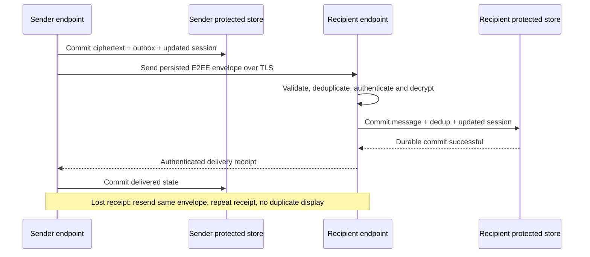

# NARADA — Chat and attachment mechanism

> **Current desktop source 0.7.0:** see [phases 5–9 scope and readiness](desktop-5-9-status.md), [current validation](desktop-5-9-validation.md) and [cryptography decision](crypto-content-decision.md). Original cross-platform/native/security acceptance checkboxes remain open where evidence is missing. Android is still deferred.

> [Documentation index](../README.md) · Planning baseline v1.0 · 30 October 2026  
> Proposed design; implementation and validation are still required.

## Endpoint and persistence model

Both Windows and Android have a chat endpoint with:

- E2EE identity and session storage through the chosen library.
- Protected drafts/history and conversation metadata.
- Durable outgoing encrypted envelopes.
- Incoming deduplication records and receipt state.
- Attachment blob references, keys and lifecycle state.

A general metadata DB may mirror non-sensitive UI status, but **outbox/session or inbox/session correctness must not depend on a transaction split between two independent databases**.

## Sending without ratchet-state loss

1. Allocate a stable logical message ID and validate size/conversation.
2. Serialize encryption for the relevant session or use the library's approved concurrency model.
3. In the required transactional boundary, store protected local display content, produce the encrypted envelope, update session state and persist the outbox record.
4. Commit before transmitting.
5. Send the stored ciphertext when the intended authenticated peer is reachable.
6. On a transient failure or lost receipt, retry the same persisted envelope rather than advancing the ratchet again for the same logical message.
7. Store the durable delivery receipt and update the message state transactionally.

If the selected library cannot integrate safely with this persistence model, change the adapter/design during the feasibility phase. Do not “fix” state corruption by resetting encryption silently.

## Receiving and acknowledging

1. Validate the authenticated transport peer, frame size, conversation and message identity.
2. Check `(conversation, sender identity, message ID)` and stored envelope digest.
3. If the same message/digest was already durably accepted, resend its receipt without displaying or decrypting it again.
4. A reused ID with different ciphertext/content is rejected and logged without secrets.
5. Authenticate/decrypt using the chosen E2EE protocol and bounded skipped-key/out-of-order handling.
6. Atomically persist protected message/history data, accepted envelope identity, deduplication record and updated cryptographic state.
7. Commit the durable transaction using the tested storage policy.
8. Send a recipient-authenticated delivery receipt referencing the message and accepted envelope identity.
9. Render the message and update unread state. Optional read receipts require a separate user-visible read event.

An inbox that has merely queued bytes for later authentication has not crossed NARADA's delivery boundary. Invalid ciphertext and unrecoverable session errors do not receive a successful delivery receipt.



## Message status vocabulary

| State | Exact meaning |
|---|---|
| `pending` | Saved locally; intended endpoint has not durably acknowledged it. |
| `sending` | A transmission attempt is active. |
| `accepted` / “sent, awaiting confirmation” | Optional explicit application-level transport acceptance; not delivery. A socket write alone is insufficient even for this status. |
| `retry_wait` | Retained locally for another permitted attempt. |
| `delivered` | Intended recipient authenticated and durably committed the message/session state and returned a valid receipt. |
| `read` | Recipient acknowledged viewing under enabled read-receipt policy. |
| `failed` / `action_required` | Permanent failure, expiry, identity change or user intervention required. |

Read receipts are a follow-up feature, off by default. Presence and typing are ephemeral hints, not evidence of delivery or reading.

## Offline semantics and ordering

- No reachable recipient means the message stays on the sender. There is no implied cloud mailbox or third-device relay.
- On Android, force-stop prevents the app from behaving like an always-on messenger; user reopening may be needed.
- Bound outbox size and retry age. When an automatic retry horizon expires, preserve the user's local text but require an explicit resend decision.
- Use protocol/session ordering and stable IDs. Display timestamps are not a trustworthy global ordering clock.
- Protect prekey/session material and use the selected library's identity-change, exhaustion and reset procedures.
- Avoid infinite skipped-key storage, unbounded sessions or one new session per malicious frame.
- Do not advertise forward secrecy or post-compromise recovery beyond the selected protocol's documented and tested configuration.

## Encrypted attachment pipeline

1. Select a source through an authorized root or Android storage grant.
2. Create an immutable content snapshot or otherwise prove stable source bytes.
3. Generate a fresh per-attachment content key using the chosen library's requirements.
4. Encrypt into an immutable ciphertext blob with a reviewed streaming AEAD format.
5. Persist the blob manifest and key reference in protected local storage before creating the outgoing message.
6. Send encrypted attachment metadata inside the E2EE message: content key, format parameters, safe original display name, lengths and integrity information as appropriate.
7. Move only ciphertext through the ordinary transfer engine, with peer-scoped access and quotas.
8. Receiver verifies ciphertext transport integrity, then streaming authentication/decryption and complete plaintext integrity before publication/export.
9. Treat previews as untrusted files; never execute content automatically.
10. Retain the blob while referenced by pending work; expire or remove it only under the documented attachment-retention policy.

The transfer engine's chunk boundaries and encryption record boundaries need not be identical. Use the library-defined format, including ordering/final-record authentication. Do not invent “nonce = chunk number” encryption or reuse a key/nonce for changed content.

**Resume rule:** Retry immutable ciphertext bytes. If initial encryption is interrupted and safe continuation is not supported by the library, discard the partial encrypted blob and restart encryption with a fresh key. Do not reconstruct encryption state heuristically.

## Attachment status is independent

```text
Message:     pending → delivered
Attachment:  not_requested → queued → downloading → verifying → available → exported
```

A delivered message may reference an unavailable or expired blob. Display that explicitly and allow re-request where possible. A file reference to an original Windows path is a later feature and is not equivalent to a permanent snapshot attachment.
