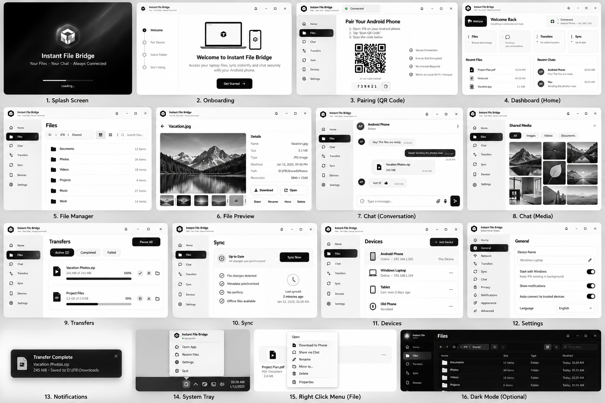

# NARADA — Desktop UI Specification

> [Documentation index](../README.md) · User-supplied visual direction · 30 October 2026  
> This is a production UI specification, not a claim that the prototype is a working application.

## 1. Reference inputs and design precedence

Use these supplied references for the Windows desktop interface:

1. [Detailed Files workspace](../references/desktop-files-reference.png): primary reference for the file browser, folder tree, toolbar and right-hand inspector.
2. [Sixteen-screen overview](../references/desktop-screens-reference.png): primary reference for overall visual consistency and screen/surface coverage.
3. [Original desktop HTML prototype](../references/original-desktop-prototype.html): a useful layout/interaction starting point, not production behavior.

The detailed image contains a folder tree that is not implemented in the HTML's simpler table-plus-inspector layout. **Use the image's richer Files layout as the target**, adapting it responsively rather than treating the HTML as pixel-perfect finished code.



## 2. Visual direction to preserve

- Premium but restrained monochrome appearance: white/light-gray surfaces, dark text and black primary actions.
- A persistent left navigation rail, top connection/status area, central workspace and contextual right inspector.
- Rounded panels and controls, subtle borders and shadows, generous spacing and compact information density.
- Dark filled selected navigation, pale selected rows, simple line icons and quiet separators.
- Clear file metadata, transfer progress, chat bubbles and device cards.
- Light theme first. Dark theme is a later capability using the same layout and tested semantics.

**Replace all product-facing branding with NARADA.** Proposed short descriptor: **Files · Sync · Private chat**. Do not retain “Always connected,” which conflicts with laptop sleep and Android lifecycle limits.

The referenced geometric logo is a visual direction, not a newly created or legally cleared NARADA identity. Use an approved local vector mark or temporary wordmark until branding assets are finalized.

## 3. Design tokens

Starting tokens, subject to contrast and real-device testing:

```css
:root {
  --color-canvas: #f3f3f3;
  --color-surface: #ffffff;
  --color-surface-subtle: #f8f8f8;
  --color-text: #111111;
  --color-text-muted: #626262;
  --color-border: #e7e7e7;
  --color-selected: #efefef;
  --color-primary: #090909;
  --color-on-primary: #ffffff;
  --color-error: #a32626;
  --color-focus: #111111;
  --radius-control: 10px;
  --radius-card: 16px;
  --radius-shell: 18px;
  --space-1: 4px;
  --space-2: 8px;
  --space-3: 12px;
  --space-4: 16px;
  --space-6: 24px;
  --space-8: 32px;
  --sidebar-width: 230px;
  --topbar-height: 72px;
  --folder-tree-width: 184px;
  --inspector-width: 280px;
}
```

- Font: native system stack, prioritizing Segoe UI on Windows. A bundled font is optional; no CDN dependency.
- Body: 14–16 px; page heading: 24–28 px; major onboarding heading: 30–36 px.
- Avoid the prototype's 9–11 px essential labels and pale gray text for critical information.
- Use monochrome SVG icons instead of emoji/Unicode approximations that vary by OS.
- Success/warning/error may use small semantic accents, but always include an icon and text. Meaning must not depend on color alone.
- Test WCAG AA contrast: normal text at least 4.5:1, large text 3:1, and relevant control/focus boundaries at least 3:1. Decorative separators need not be mistaken for interactive boundaries.

## 4. Application shell and responsive behavior

### Navigation

**Home · Files · Chat · Transfers · Sync · Devices · Settings**

- Put **Offline files** under Sync, with a direct shortcut from Files and Home.
- Add a **Files → Trash** secondary view for retained items and safe restore; the 16-screen reference is a visual catalogue, not a ban on required safety views.
- Treat Notifications as a panel/secondary view, Preview as a contextual route, and Shared media as a conversation subview.
- System tray and context menu are native/overlay interaction surfaces, not primary sidebar destinations.
- Theme controls belong in Settings → Appearance, not a permanent “Dark mode” navigation item.

### Files workspace

```text
┌──────────────── NARADA / connection / search / window controls ────────────────┐
│ Sidebar │ Files heading and approved-root selection                         │
│         │ Back / Forward / Breadcrumb / View / Search / Sort                 │
│         ├──────────────┬─────────────────────────────┬───────────────────────┤
│         │ Folder tree  │ File table or qualified grid │ Preview / inspector   │
│         │              │ Name / Size / Type / Modified│ Primary action        │
│         │              │ Selection + item actions     │ Safe file operations  │
│ Peer    │              │                             │ Version / availability│
│ card    │              │                             │ Integrity details     │
└─────────┴──────────────┴─────────────────────────────┴───────────────────────┘
```

- At a wide window, show all panes. At narrower widths, collapse the folder tree and convert the inspector to a drawer.
- Start testing around 1440×900, 1280×720 and a narrow 960-pixel-wide layout, at 100%, 150% and 200% display scale. These are test sizes, not guarantees of a fixed pixel-perfect viewport.
- Use flexible heights and scroll containers. Remove hard minimum-height assumptions that cut off controls on small laptops.
- Keep keyboard focus, selection and scroll position when opening/closing details.
- Use one deliberate window chrome strategy: native title bar, or correctly implemented Tauri drag regions/window controls. Never draw decorative close/maximize buttons that do not work.

### Local versus remote context

The Windows Files page manages **approved local folders shared with the phone**. Its heading should say that, not suggest the desktop is remotely browsing itself.

Local owners may see an approved local path in Properties. Android receives the root label and relative path, not `D:\...` host paths. The peer storage card must identify what storage is being measured and when the report was last received; do not hard-code device-wide free space.

## 5. Sixteen-screen/surface mapping

| Reference | Production destination | Required behavior | Release scope |
|---|---|---|---|
| 1. Splash | Native launch/loading state | Show actual initialization; no fake fixed progress or artificial delay. | P0 |
| 2. Onboarding | First-run setup flow | Explain local-only operation, choose root/grants, pair, run a test; skip leads to an unpaired state. | P0 |
| 3. Pairing | Devices → Add device | Real temporary QR, countdown, local approval, fingerprint and expiry/retry states. | P0 |
| 4. Dashboard | Home | Real connection, recent work, transfer queue and metadata/content freshness. | P0 |
| 5. File manager | Files | Root-scoped navigation, pagination, selection, search, sorting and inspector. | P0 list; richer grid P1 |
| 6. File preview | Files → Preview | Safe images first; safe external-open fallback with clear warning. | P0 images; PDF/audio P1 |
| 7. Conversation | Chat → Paired endpoint | Protected history, pending/delivered states and encrypted attachments. | P0 |
| 8. Shared media | Conversation → Media | Query actual attachments, filter by type and show unavailable/expired states. | P1 gallery; attachment rows P0 |
| 9. Transfers | Transfers | Actual preparing/active/paused/verifying/committing/completed/failed state. | P0 |
| 10. Sync | Sync + Offline subview | Separate metadata freshness, content refresh, stale pins and conflicts. | P0 one-way refresh |
| 11. Devices | Devices | Current laptop, one paired phone, trust details, grants and revoke. | P0; additional peers P1 |
| 12. Settings | Settings categories | Persisted settings, permissions, privacy, quotas and diagnostics. | P0 core settings |
| 13. Notifications | Native Windows notification + in-app history | Announce durable outcomes; body/path previews private by default. | P0 |
| 14. System tray | Native Tauri/Windows tray | Open, view queue, pause/resume, settings, close window, exit agent distinctly. | P0 |
| 15. File context menu | Row menu / Shift+F10 | Selected-item identity, permission-filtered actions and confirmations. | P0 core; move/copy P1 |
| 16. Dark mode | Settings → Appearance | Real token-based theme, persisted preference and contrast tests. | P1 |

The reference's full surface catalogue does not automatically promote deferred features to the first release. Hide unavailable actions or clearly label them in development prototypes; do not ship decorative buttons pretending to work.

## 6. Actions and backend contracts

| UI action | Actual process | Required response |
|---|---|---|
| Select folder | Native picker in interactive shell → typed IPC → agent validates/registers root | Approved root or actionable rejection. Do not launch an interactive picker from a noninteractive service. |
| Select file | Update local selection; request authorized details/version | Every inspector field derives from the selected record. |
| Open folder | Navigate by root/object ID | New page, safe breadcrumbs and restored Back history. |
| Preview | Authorized bounded preview request | Loading, supported preview, unavailable or unsafe-format fallback. |
| Send to phone | Queue peer-scoped transfer offer over live control channel; phone accepts and pulls through normal transfer API | Pending offer until phone is reachable/accepts; no forced write to arbitrary phone paths. |
| Download on phone | Android creates a normal authorized download | Transfer state/verified destination, not just “queued” toast. |
| Rename | Typed mutation with expected version and idempotency key | Committed name, or conflict/permission/invalid-name error. |
| Move to trash | Confirm exact item, root and scope; authorized mutation | Durable trash result with retention/restore information. |
| Share via chat | Explicit snapshot attachment pipeline | Encryption/preparation progress, message state and attachment state. |
| Pin/unpin | Change desired pin state for the permitted peer | Actual device availability and offline-copy state, not an immediate success icon. |
| Sync now | Request metadata reconciliation and schedule eligible refresh jobs | Distinct metadata and content outcomes; no claim of global two-way sync. |
| Revoke | Local owner confirmation → agent revocation | Sessions close and new work is denied; prior copies cannot be recalled. |

A desktop **Send to phone** offer carries only authorized root/file/version references and expires under a documented policy. The phone owns its receive destination and acceptance policy. A notification must not bypass Android background restrictions or storage consent.

## 7. Findings from the supplied HTML

This is a static source review; it is not a browser, accessibility or security audit.

| Observed prototype behavior | Production change |
|---|---|
| `makeQR()` draws a deterministic cell pattern | Replace with a standards-compliant QR encoder for the real invitation. The visual pattern is not a secure pairing payload. |
| Pairing code `739 421` and countdown are hard-coded | Remove the decorative short-code path from P0. A future short-code method needs a separately reviewed protocol/rate-limit design, not six digits as a bearer secret. |
| Many buttons call `toast(...)` only | Wire to typed domain operations with persisted result/error state. |
| Main screen starts on a hard-coded connected Home | Hydrate actual agent/peer state; render unpaired, offline, reconnecting and denied cases. |
| File selection updates only some inspector fields | Bind name, type, size, version, modified time, path scope and actions from one selected object. |
| Global search says files/chats/devices but only filters files | Label it “Search shared files” in 1.0; add separate result types only when implemented. |
| Completed items appear in Active, while Completed can show empty | Derive tabs and counts from one transfer-state selector. |
| Preview/shared-media/theme surfaces are not fully wired into the normal flow | Add real route entry points and Back navigation. |
| `toggleDark()` changes a preview to the same already-dark background | Implement full theme tokens and persisted preferences, or defer the theme. |
| “Local network only” looks like an optional switch | Make it an explanatory product policy in 1.0; switching it off must not imply a WAN feature exists. |
| App-lock switch has no enforcement | Omit or defer it until an actual authentication/threat model exists. |
| Notification-preview hiding defaults off | Default private notification content on both platforms. |
| Toggles/modals/rows lack complete accessibility semantics | Add names, switch state, focus management, keyboard behavior and screen-reader announcements. |
| Inline event handlers and template `innerHTML` are used | Refactor to ES modules and safe DOM/component construction compatible with the production CSP. Static template strings are not themselves evidence of an exploit; do not later interpolate untrusted content into them. |
| `sendMessage()` uses `textContent` | Preserve this safe rendering pattern; add real protected persistence and protocol states. |

## 8. Shared components and implementation structure

```text
components/
  AppShell.js          Sidebar.js           ConnectionBadge.js
  FileTable.js         FolderTree.js        Breadcrumbs.js
  FileInspector.js     PreviewPanel.js      PermissionBadge.js
  TransferRow.js       MessageBubble.js     AttachmentCard.js
  EmptyState.js        ErrorState.js        ConfirmDialog.js
  ContextMenu.js       ToastRegion.js       SettingsSwitch.js
pages/
  home/ files/ chat/ transfers/ sync/ devices/ settings/
services/
  ipc.js               files.js             transfers.js
  chat.js              devices.js           sync.js
styles/
  tokens.css           base.css            layout.css
  components.css       themes.css
```

Use mock fixtures behind an explicit development adapter. Production view state comes from repository/IPC responses and committed events. The frontend never constructs cryptographic sessions, opens arbitrary host paths or stores keys in browser local storage.

## 9. Accessibility and interaction rules

- All actions work without a mouse. Use visible focus and semantic buttons/inputs.
- `Ctrl+K`: focus shared-file search; `Ctrl+F`: current context search; `F2`: rename when permitted; `Shift+F10`: selected item's menu; `Escape`: dismiss and restore focus.
- Do not intercept destructive shortcuts while the user is editing text.
- `Enter` on a folder navigates; `Enter` on a file invokes an explicit safe preview/open policy, not arbitrary executable launch.
- Context menus are clamped to the viewport and follow selection. Modals trap focus appropriately and return it to the invoker.
- Announce errors and important state transitions without flooding assistive technology with every progress tick.
- Respect reduced motion, high contrast and increased text scale.
- Truncate visually with accessible full names; expose the full filename in details. Treat bidirectional/control characters carefully.

## 10. Desktop acceptance checklist

- [ ] All public branding says NARADA; old branding exists only in preserved references.
- [ ] Files layout follows the detailed reference, including responsive tree/inspector behavior.
- [ ] Every P0 surface has loading, empty, offline, denied, recoverable-error and success states where applicable.
- [ ] No fake QR, fabricated connected state, static success metric or placeholder action remains in production.
- [ ] Invalid/revoked operations stay blocked even if a user calls IPC directly.
- [ ] 100% transferred is not labeled complete before verification/publication.
- [ ] Close window, minimize to tray, disconnect and exit agent have distinct behavior.
- [ ] Folder selection, notifications and tray are actual native integrations.
- [ ] Keyboard, screen-reader, contrast, display scaling and narrow-window tests pass.
- [ ] Deferred P1/P2 controls are not presented as working 1.0 features.

Related: [Android UI](13-android-ui.md), [Architecture](04-architecture.md), [Protocol](06-communication-protocol.md), [Tasks](15-task-backlog.md).
