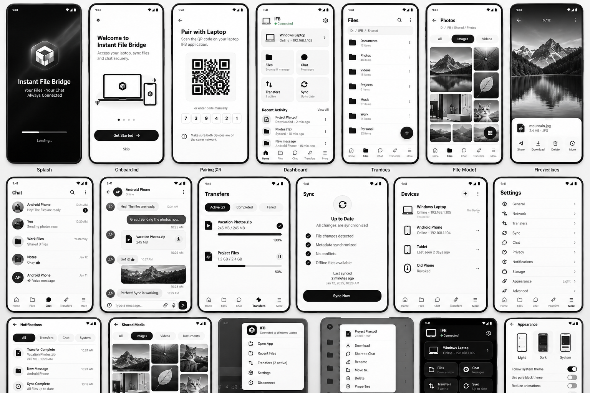

# NARADA — Android Mobile UI Specification

> **Android implementation update, 31 October 2026:** the native [Phase 1 foundation](android/phase-1.md) is delivered with [82 passing host tests](android/validation.md), development APKs and a separate [phase-wise roadmap](../android-plan.md). This specification remains broader than the implemented phase; no device/crypto/LAN qualification is implied.

> [Documentation index](../README.md) · User-supplied mobile visual direction · 30 October 2026  
> Implement natively in Kotlin/Jetpack Compose. The HTML is a design prototype, not the Android application.

## 1. Reference inputs

- [Mobile screen overview](../references/android-screens-reference.png): visual direction, mobile density, bottom navigation, file actions, chat, transfer cards and appearance.
- [Original Android HTML](../references/original-android-prototype.html): interactive design reference with simulated behavior.
- [Desktop UI specification](12-desktop-ui.md): shared brand vocabulary, monochrome color system and consistent domain terminology.

The mobile HTML contains **17 screen sections**, although its header says “16 mobile screens.” The image also illustrates variants such as a photo grid, dark Home and notification-style quick actions. Treat those as states/surfaces, not a requirement to force every feature into an arbitrary screen count.



## 2. Mobile visual direction

Preserve white surfaces, near-black primary actions, restrained gray separators, rounded cards, simple icons, readable file rows and dark outgoing chat bubbles.

- Replace all user-facing branding with **NARADA**.
- Suggested descriptor: **Files · Sync · Private chat**.
- Use native Android typography and vector assets. Do not require external fonts, images or scanner model downloads.
- Use Material 3 components with a deliberate monochrome color scheme rather than unrelated dynamic accent colors by default.
- Suggested body text: 14–16 sp; title: 22–28 sp; secondary text: 12–14 sp where readable; do not scale the screenshot's tiny labels literally.
- Minimum touch target: 48×48 dp. The reference's 36–39 pixel icon buttons need larger native hit areas.
- Spacing scale: 4, 8, 12, 16, 24 and 32 dp; card radius approximately 16–20 dp.
- Respect system font scale, high contrast, reduced motion and accessibility focus.
- Light theme is P0. Dark/system theme is P1 unless explicitly promoted with testing capacity; accessibility support is not deferred.

The HTML's desktop-side screen selector, simulated phone frame, status bar time and device bezel do **not** belong inside the production Android app.

## 3. Navigation model

Top-level bottom navigation follows the reference:

**Home · Files · Chat · Transfers · More**

- **More** is a real destination exposing Sync, Offline files, Devices, Notifications, Settings and Help—not an unexplained alias that loses context.
- Files has its own nested stack: roots → folder → details/preview/action sheet.
- Chat has a nested stack: conversation list → conversation → attachments/shared media.
- Preserve each top-level destination's scroll/navigation state.
- Setup screens, full-screen preview and focused conversation can hide bottom navigation where doing so improves clarity. Use a consistent documented rule.
- On conversation screens, keep the composer above the IME and system insets; do not rely on absolute HTML positioning.
- Android Back closes sheets/keyboard, then pops the current stack, then returns according to standard navigation behavior. Support the target OS's back-navigation expectations.
- Saved navigation state must not be mistaken for active transfer state; jobs live in repositories, not Composable memory.

## 4. Screen inventory and behavior

| Reference / HTML ID | Native destination | Required behavior | Scope |
|---|---|---|---|
| `splash` | Platform startup screen | Brief genuine initialization, then setup/home/error; no forced decorative loading. | P0 |
| `onboarding` | First-run flow | Local-only explanation, permission rationale, pair prompt; skip shows unpaired Home. | P0 |
| `pairing` | Pair with laptop | Real camera viewfinder scans the laptop QR; expiry, approval and identity feedback. | P0 |
| `home` | Home | Current paired laptop, real connection/freshness, shortcuts and activity. | P0 |
| `files` | Shared roots/folder list | Authorized remote metadata, relative paths, search, sort and upload action. | P0 |
| Photo-grid image variant | Files → Images view | Lazy thumbnails and type filters over actual folder contents. | P1 grid; safe single-image preview P0 |
| `preview` | File preview | Safe bounded preview, version/availability and scoped actions. | P0 images; richer media P1/P2 |
| `chat` | Conversation list | Real paired endpoint conversations; no invented contacts or groups. | P0 one counterpart |
| `conversation` | Chat detail | Protected history, queued/delivered status, attachment card and retry. | P0 |
| `sharedmedia` | Conversation attachments | Actual filtered attachment records and availability. | P1 gallery; basic attachment actions P0 |
| `transfers` | Transfers | Active/queued/paused/verifying/failed/completed jobs and true progress. | P0 |
| `sync` | More → Sync | Metadata and selected-content refresh tracked separately. | P0 one-way refresh |
| `devices` | More → Devices | This phone and paired laptop clearly distinguished; inspect/forget local trust. | P0; multi-peer catalogue P1 |
| `settings` | More → Settings | General, network policy, storage, privacy, notifications, diagnostics and appearance. | P0 core settings |
| `notifications` | Activity inbox + native notification channels | Actual persisted events; no hidden content previews by default. | P0 |
| `offline` | More → Offline files | Verified pins, stale/source-deleted states, quota and unpin confirmation. | P0 |
| `context` | File action bottom sheet | Selected-object header and permission-filtered actions. | P0 core actions |
| `appearance` | Settings → Appearance | Real persisted light/dark/system options only when supported. | P1 extended themes |
| Quick-actions image variant | Android notification/shortcut surface | Native, policy-compliant actions; not a Windows-style system tray. | P0 transfer notifications; extra shortcuts P1 |

## 5. Critical corrections to the references

### Pairing must be a scanner, not a decorative QR on the phone

The phone scans the laptop's invitation. The HTML currently draws a CSS QR-like pattern and hard-coded digits. Production must instead provide:

1. Camera permission request only when the user chooses Scan.
2. A working native camera/decoder with an entirely offline scanning path.
3. Bounded invitation parsing and host-key verification.
4. Expired/invalid invitation feedback and a way to rescan.
5. A waiting-for-Windows-approval state.
6. A final trusted-device summary and scoped grants.

Do not treat six visible digits as a secure bearer credential. Short-code pairing is deferred unless a reviewed authentication protocol is adopted. Manual endpoint entry is a discovery fallback and still needs trusted identity or explicit secure pairing.

### Correct device and conversation identity

- On Android, **This device** is the phone, not the Windows Laptop card.
- The initial chat counterpart is the paired Windows endpoint. “Android Phone,” “Work Files,” “Notes,” saved-message threads and additional peers in mock data are not evidence of a supported multi-party messenger.
- A phone can forget its own pairing. It does not automatically gain authority to administer all other devices or grants on Windows.
- Remote grant management/revocation of other peers remains a local Windows-owner action in 1.0.

### Scope every destructive or storage action

- **Move to trash on laptop** is different from **Remove local download** or **Unpin**.
- Display the affected device, root and item before confirmation.
- Show remote mutation actions only when current grants permit them; recheck authorization on the host.
- Upload uses a native document picker and an approved host destination. It does not request unrestricted phone storage access.
- Download first means verified private receipt; Save/export to a provider is a distinct operation and status.
- “Share” uses scoped content URI grants and explicit user choice, never world-readable temporary files.

## 6. Prototype findings and production replacements

| Observed HTML behavior | Production requirement |
|---|---|
| `go('home')` begins with connected sample data | Derive startup from persisted trust and an authenticated live session. |
| Camera/manual-code controls show simulated toasts | Implement actual pairing; never accept the prototype's fixed digits. |
| `segment()` changes a selected button and shows a toast | Filters must change the underlying transfer/media/notification dataset. |
| Transfer pause changes only the icon | Send a job command and reflect the acknowledged durable state. |
| File row actions show a generic modal | Open the correct object, preserve selection and offer only authorized actions. |
| File-preview surface is not a complete file-navigation flow | Wire folder navigation, type-specific preview entry, Back state and unsupported-file fallback. |
| “Delivered” is static conversation copy | Use authenticated durable receipts from the messaging domain. |
| Shared-media tiles are decorative gradients | Query real attachment records and generate bounded local thumbnails. |
| Appearance toggles are mostly visual-only | Persist preferences and observe real system theme/accessibility settings when supported. |
| Absolute composer/navigation layout uses a fixed phone size | Use Compose Scaffold, window insets, IME handling and responsive layout. |
| Fixed labels show “all selected changes synchronized” | Compute metadata and content status separately; show pending bytes and stale pins. |
| The phone's paired laptop is marked “This device” | Correct identity labels and remove unsupported multi-peer sample entries. |
| New-message notifications reveal sample body text | Hide bodies by default and respect lock-screen privacy. |
| `sendMessage()` safely uses `textContent` but only appends a bubble | Preserve safe text rendering concept; implement transactional encrypted outbox/session storage. |

## 7. Native Compose implementation boundaries

```text
feature/<feature>/
  <Feature>Route.kt          # Navigation + lifecycle collection
  <Feature>Screen.kt         # Stateless rendering of UiState
  <Feature>ViewModel.kt      # UI intentions, repository observation
  <Feature>UiState.kt        # Loading/content/error/offline states
core/
  model/ database/ network/ security/ storage/ jobs/ designsystem/
```

- Compose observes `StateFlow` from a ViewModel using lifecycle-aware collection.
- Repositories own durable jobs, messages, receipts and pin state.
- Work scheduling is delegated to the platform adapter, not launched again on every recomposition.
- Persist stable IDs and necessary form/navigation state; never store private keys in UI saved state.
- Rotation, process recreation or leaving a screen must not duplicate a transfer/message.
- Use lazy lists/grids and bounded thumbnail decoding. Pagination is a repository contract, not a cosmetic scroll effect.
- Keep native crypto/session storage behind a tested adapter; UI neither generates encryption formats nor handles key export.

## 8. Permissions and background behavior

| Capability | User experience and boundary |
|---|---|
| Camera | Ask at Scan QR; explain denial and retry/settings path. |
| Notifications | Request contextually where required; app remains usable if denied. |
| Document selection | Use SAF grant returned by the picker; persist only offered/granted access. |
| External export | Provider may be remote, non-seekable or non-atomic; show real export guarantees. |
| Local-network discovery | Qualify NSD and any permissions needed by the actual target OS/API; do not ask for unrelated broad permissions by habit. |
| Active transfer | Use the validated user-initiated job/foreground mechanism, with progress and cancel actions. |
| Deferred refresh | WorkManager with constraints; timing is not exact and interruption is expected. |
| Force-stop / battery restriction | Explain that work or chat can wait for the app to become eligible or reopen. Do not promise permanent presence. |

Do not ask for `MANAGE_EXTERNAL_STORAGE` merely to simplify uploads. Do not ask users to disable every battery or firewall protection as the default troubleshooting path.

## 9. Shared state vocabulary

- Connection: **Unpaired / Offline / Connecting / Connected / Identity changed / Access revoked**.
- File: **Remote only / Downloading / Verifying / Local copy / Pinned / Stale / Source missing**.
- Transfer: **Preparing / Queued / Receiving or Sending / Paused / Retrying / Verifying / Saving / Complete / Failed**.
- Message: **Pending / Sending / Waiting for confirmation / Delivered / Read if enabled / Action required**.
- Attachment: **Not downloaded / Downloading / Verifying / Available / Exporting / Export failed / Expired**.

Use the same meanings as desktop, not necessarily the same widget layout. Never infer “online,” “verified,” “delivered” or “up to date” solely from a recent tap.

## 10. Android acceptance checklist

- [ ] Native Kotlin/Compose application follows the supplied mobile visual direction.
- [ ] Five-tab navigation and nested Back behavior are coherent; More exposes Sync/Offline/Devices.
- [ ] Real scanner works without internet or first-use model downloads.
- [ ] No decorative QR/code, fake peer, hard-coded receipt or placeholder action remains in production.
- [ ] UI handles 360–480 dp widths, font scale up to 200% in tests, gesture insets and keyboard visibility.
- [ ] TalkBack names, order, control states and 48 dp touch targets are tested.
- [ ] Rotation/process death does not create duplicate jobs or messages.
- [ ] Permission denial, URI revocation, disk full and unavailable cloud providers have actionable states.
- [ ] Background restrictions/timeouts pause safely and do not corrupt transfer/session state.
- [ ] The interface distinguishes laptop originals, managed phone copies, pins and external exports.
- [ ] Notification content is private by default; sent versus delivered is truthful.
- [ ] Multi-peer, voice-note, gallery and dark-theme mockups do not imply unapproved 1.0 scope.

Related: [Tech stack](03-tech-stack.md), [End-to-end working](07-end-to-end-working.md), [Transfer mechanism](08-transfer-mechanism.md), [Testing](18-testing-validation.md).
