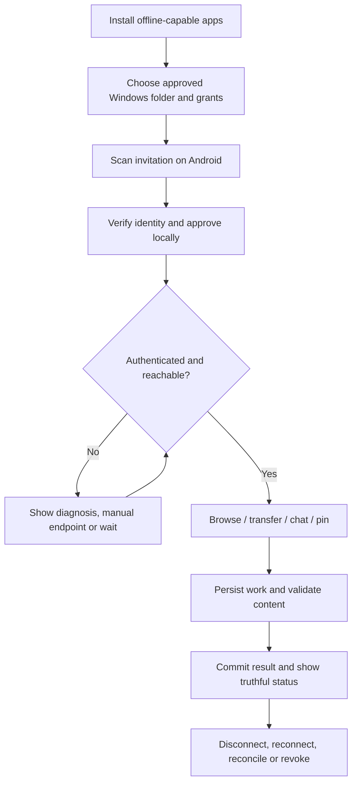

# NARADA — Workflows, Processes and Team Communication

> [Documentation index](../README.md) · Proposed operating model · 30 October 2026

## 1. Main user workflow



For exact device communication and failure branches, use [End-to-end working](07-end-to-end-working.md) and [Communication protocol](06-communication-protocol.md).

## 2. Feature development process

1. **Define the job:** User problem, release priority, scope and explicit non-goals.
2. **Write acceptance cases:** Include success, offline, permission denial, cancellation, crash and retry.
3. **Design contracts first:** IDs, permissions, payload limits, states, errors and compatibility.
4. **Review risky boundaries:** Filesystem writes, pairing, cryptographic state and destructive actions need security review before integration.
5. **Build a vertical slice:** Real Windows and Android interaction before expanding visual polish or optional abstractions.
6. **Implement persistence and recovery:** The happy path is not complete without restart behavior.
7. **Integrate UI:** Desktop and Android use the same domain vocabulary with native layouts.
8. **Automate tests:** Unit, contract, integration, recovery and relevant UI tests.
9. **Measure:** CPU, memory, network, battery and user-perceived latency on declared hardware.
10. **Review and merge:** Evidence, docs, migrations and compatibility reviewed together.
11. **Run a limited pilot:** Use synthetic or user-consented data; collect diagnostics locally.
12. **Release through gates:** No feature bypasses the security/data-integrity gate to meet a date.

## 3. Task lifecycle

```text
PROPOSED → READY → IN_PROGRESS → REVIEW → VALIDATION → DONE
                     ↘ BLOCKED → READY
```

- `READY` requires a named owner, dependencies, acceptance criteria and a known test strategy.
- `BLOCKED` includes the unresolved decision, owner and next experiment—not just “waiting.”
- `DONE` means the definition of done in [Task backlog](15-task-backlog.md), not merely merged code.
- Deferred work stays visible with a release label; do not quietly omit a feature while preserving its marketing claim.

## 4. Roles and accountability

These are role assignments for planning, not claims about an existing team.

| Role | Owns | Must coordinate with |
|---|---|---|
| Product/design (PM) | User needs, scope, reference interpretation, copy and priorities | All engineering owners and QA |
| Core/Windows (CORE) | Agent, filesystem, protocol server, transfer and metadata durability | Android, security and release |
| Android (AND) | Native app, storage providers, networking and lifecycle | Core, design and QA |
| Desktop UI (DESK) | Vanilla UI, Tauri bridge, accessibility and tray UX | Core, design and QA |
| Security reviewer (SEC) | Threat model, crypto integration and high-risk approvals | Core and Android |
| Quality/performance (QA) | Acceptance matrix, hardware coverage, fault tests and reports | All implementation owners |
| Release/support (REL) | Signing, packaging, update/migration readiness and incident response | Security, QA and product |

One person can hold multiple roles in a small team, but security-sensitive work still needs a qualified second review where feasible. Release accountability must be explicit.

## 5. Team communication process

| Cadence / event | Information exchanged | Durable output |
|---|---|---|
| Daily asynchronous update | Completed evidence, next task, blocker and help needed | Short task-linked update |
| Weekly planning/review | Scope changes, dependencies, risks, metrics and next slice | Prioritized board and milestone forecast |
| Protocol/schema change | Proposed contract, affected clients, compatibility and test vectors | Versioned contract + ADR when material |
| UI review | Reference comparison, actual state behavior, accessibility and copy | Annotated screenshots and decision notes |
| Security-sensitive change | Threat, abuse cases, mitigations and test evidence | Reviewer approval or blocking finding |
| Phase exit | Deliverables, test results, open issues and go/no-go | Signed-off phase checklist |
| Release review | Known limitations, signing, recovery, docs and support readiness | Release record and artifact manifest |
| Incident | User impact, containment, owner, next update time | Incident log and postmortem |

Rules:

- Link decisions to task/ADR/test IDs; do not let chat become the only source of truth.
- Discuss private vulnerabilities in a restricted channel; never post keys, QR invitations, user documents or plaintext chat to public issues.
- Clarify who must decide versus who only needs notification.
- When a claim changes, update **both clients, documentation, test expectations and release notes**.
- A change to “delivered,” “verified” or “up to date” is a protocol/product change, not merely copy editing.

## 6. Pull request template

```markdown
## Problem and scope
- Task ID:
- User outcome:
- Explicit non-goals:

## Implementation and compatibility
- Modules affected:
- Protocol/schema/migration changes:
- Supported old/new client combinations:

## Safety and evidence
- Authorization/privacy impact:
- Crash/retry/cancellation behavior:
- Unit/integration/device test evidence:
- Resource measurements if relevant:
- UI screenshots and accessibility checks:

## Delivery
- Documentation updated:
- Roll-forward/rollback plan:
- Known limitations:
- Required reviewers:
```

## 7. CI and integration process

1. Validate formatting, lint and forbidden secret patterns.
2. Compile Windows and Android targets with pinned toolchains.
3. Run unit and shared protocol-vector tests.
4. Run database/migration and API integration tests.
5. Run deterministic failure-injection tests for modified mechanisms.
6. Generate dependency/license/security reports and SBOMs.
7. Build unsigned test artifacts for controlled device testing.
8. Keep release signing in a restricted, audited pipeline; never expose signing credentials to untrusted pull requests.

A cross-platform client/server change is not complete when only one platform's tests pass.

## 8. Operational processes

### Startup/shutdown

Recover durable state → validate trust/storage → bind approved interfaces → expose readiness. On shutdown: stop accepting new work → checkpoint/cancel eligible jobs → flush records → close handles → publish final lifecycle state.

### Permission/root change

Validate local owner intent → increment scope revision → invalidate affected caches/cursors → cancel unauthorized work → notify the peer → reauthorize all future operations.

### Cleanup

Calculate retention and active references → list safe candidates → delete only unreferenced managed data → update indexes → record a redacted outcome. Never use broad filesystem glob deletion against user-selected roots.

### Support

Ask for app/OS versions, operation ID and user-visible error first. Request a user-inspected diagnostic export only if necessary. Reproduce using synthetic files; never ask users to reveal private keys or disable authentication.

## 9. Process success signals

- Every release feature maps to an owner, task, test and product claim.
- Cross-platform contract disagreements are resolved before integration, not after user data is affected.
- Blocking risks have a next experiment and a decision date.
- UI references are followed without inheriting simulated security or fake success state.
- An incident produces a regression test and a reviewed prevention change, not only a patch.
